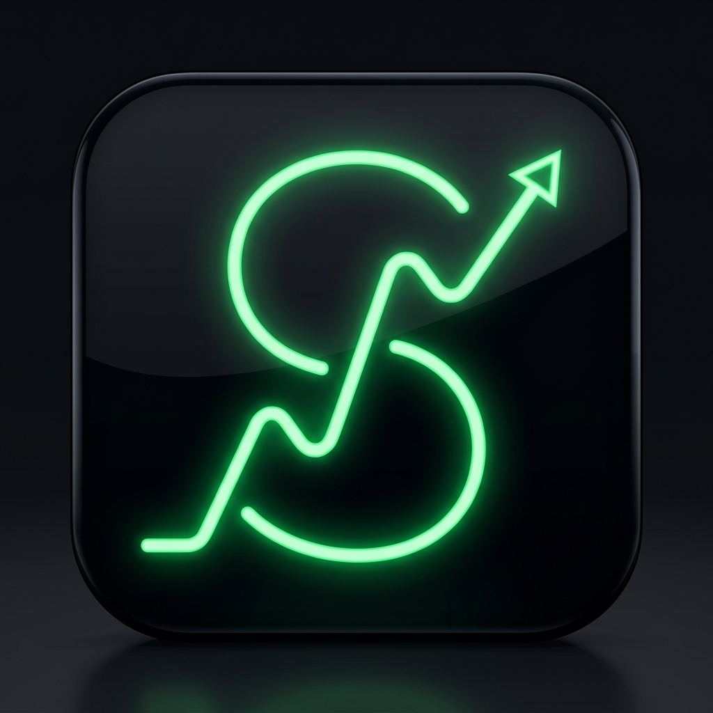

<div align="center">

  <br />

  

  # SkinStock

  ### **The Next-Gen Real-Time Counter-Strike 2 Market Ticker & Portfolio Tracker**

  [](https://github.com/artjomartur/SkinStock)
  [](https://github.com/artjomartur/SkinStock)
  [](https://github.com/artjomartur/SkinStock)
  [](https://github.com/artjomartur/SkinStock)
  [](LICENSE)

  <p align="center">
    <strong>Track CS2 market swings, evaluate your entire inventory in Steam & Cashout values, simulate trade-up contracts with mathematical precision, and stay ahead with live iOS & Android home screen widgets.</strong>
  </p>

  <p align="center">
    <a href="#-key-features"><b>Explore Features</b></a> •
    <a href="#-beta-program"><b>Join Public Beta</b></a> •
    <a href="#-tech-stack"><b>Tech Stack</b></a> •
    <a href="#-quick-start"><b>Quick Start</b></a> •
    <a href="#-architecture"><b>Architecture</b></a>
  </p>

  <br />

</div>

---

## 🚀 Public Beta (v1.0.0-beta)

> [!IMPORTANT]
> **SkinStock is currently in open Public Beta!**  
> We are actively rolling out live market ticker updates, native iOS WidgetKit extensions, real-time portfolio synchronization, and the advanced CS2 Trade-Up Contract simulator.  
> Have feedback or want to request a feature? Open an issue or join our beta discussions!

---

## ✨ Key Features

<table>
  <tr>
    <td width="50%" valign="top">
      <h3>📈 Real-Time Market Ticker & Charts</h3>
      <ul>
        <li>Live price streaming from verified CS2 market sources and liquidity providers.</li>
        <li>Dual valuation modes: <b>Steam Community Market</b> & <b>Real-World Cashout (Skinport)</b> rates.</li>
        <li>Interactive high-performance candlestick and area charts powered by <code>TradingView Lightweight Charts</code>.</li>
      </ul>
    </td>
    <td width="50%" valign="top">
      <h3>🎒 Smart Inventory Valuation</h3>
      <ul>
        <li>One-click Steam inventory import via <b>SteamID64</b> or Steam OpenID.</li>
        <li>Exact wear float tracking (Factory New down to Battle-Scarred).</li>
        <li>Automatic detection of rare <b>Doppler phases</b>, applied sticker values, and trade-lock timers.</li>
      </ul>
    </td>
  </tr>
  <tr>
    <td width="50%" valign="top">
      <h3>🧪 Mathematical Trade-Up Calculator</h3>
      <ul>
        <li>Precise outcome simulation based on CS2 collection drop tables and float ranges.</li>
        <li>Real-time ROI computation, profitability probability, and breakeven thresholds.</li>
        <li>Interactive float slider and ingredient optimizer.</li>
      </ul>
    </td>
    <td width="50%" valign="top">
      <h3>🏆 Gamified Collector Achievements</h3>
      <ul>
        <li>Unlock tier badges from <i>Starter</i>, <i>Investor</i> to <i>Whaler</i> and <i>Legende</i> (€10k+).</li>
        <li>Milestone celebrations with confetti, sound design, and haptic feedback.</li>
        <li>Visual portfolio diversification breakdown by rarity tiers.</li>
      </ul>
    </td>
  </tr>
  <tr>
    <td width="50%" valign="top">
      <h3>📲 Native iOS & Android Integration</h3>
      <ul>
        <li>Full native experience built on <b>Capacitor 8</b> and Swift / Kotlin.</li>
        <li><b>iOS Home Screen & Lock Screen Widgets</b> via WidgetKit + AppIntents.</li>
        <li>Dynamic Island / Live Activity support for active trade-locks and price swings.</li>
      </ul>
    </td>
    <td width="50%" valign="top">
      <h3>🔔 Price Alerts & Instant Sync</h3>
      <ul>
        <li>Custom thresholds: set target buy/sell price alerts on any CS2 skin.</li>
        <li>Local push notifications powered by native background handlers.</li>
        <li>Seamless cross-device sync with Firebase Firestore & Anonymous Auth.</li>
      </ul>
    </td>
  </tr>
</table>

---

## 🎨 Visual Identity & App Icon

<div align="center">
  <table>
    <tr>
      <td align="center" width="220">
        
        <br />
        <b>Official App Icon</b>
      </td>
      <td align="center" width="220">
        
        <br />
        <b>PWA / Maskable Icon</b>
      </td>
      <td align="center" width="220">
        
        <br />
        <b>Vector Brand Favicon</b>
      </td>
    </tr>
  </table>
  <p><i>Crafted for instant recognition on iOS Springboard, Android App Drawer, and browser tabs with high-contrast emerald neon accents.</i></p>
</div>

---

## 🛠️ Tech Stack & Architecture

SkinStock is engineered with a modern, high-performance hybrid stack:

```
┌─────────────────────────────────────────────────────────────┐
│                    SkinStock Ecosystem                     │
└─────────────────────────────────────────────────────────────┘
          │                                      │
          ▼                                      ▼
┌──────────────────┐                   ┌──────────────────────┐
│  Web & PWA App   │                   │  Native Mobile Apps  │
│  (React 19/Vite) │                   │  (Capacitor 8 iOS)   │
└─────────┬────────┘                   └──────────┬───────────┘
          │                                       │
          ├───────────────────────────────────────┤
          │                                       │
          ▼                                       ▼
┌──────────────────┐                   ┌──────────────────────┐
│  Cloudflare Edge │                   │  Firebase Backend    │
│  Workers Proxy   │                   │  Auth + Firestore    │
└─────────┬────────┘                   └──────────┬───────────┘
          │                                       │
          └───────────────────┬───────────────────┘
                              ▼
                 ┌─────────────────────────┐
                 │  Live CS2 Market Feeds  │
                 │  Steam Community API    │
                 │  Skinport / CSGOTrader  │
                 └─────────────────────────┘
```

| Domain | Technologies |
|:---|:---|
| **Core Frontend** | [React 19](https://react.dev/), [Vite 8](https://vitejs.dev/), [Framer Motion](https://www.framer.com/motion/), [Lucide Icons](https://lucide.dev/) |
| **Financial Charting** | [TradingView Lightweight Charts](https://tradingview.github.io/lightweight-charts/), Recharts |
| **Mobile Runtime** | [Capacitor 8](https://capacitorjs.com/), Swift / SwiftUI (Widgets & Live Activities), Kotlin (Android) |
| **Cloud & Backend** | [Cloudflare Workers](https://workers.cloudflare.com/), [Firebase Auth & Firestore](https://firebase.google.com/) |
| **Micro-Interactions** | Canvas Confetti, tsParticles, React Parallax Tilt, Haptics |

---

## ⚡ Quick Start

### Prerequisites
- **Node.js** >= 20.x
- **npm** >= 10.x
- *(Optional for iOS)* **macOS** with Xcode 16+
- *(Optional for Android)* **Android Studio** Ladybug+

### 1. Clone the repository
```bash
git clone https://github.com/artjomartur/SkinStock.git
cd SkinStock
```

### 2. Install dependencies
```bash
npm install
```

### 3. Run development server
```bash
npm run dev
```
Open your browser at `http://localhost:5173` to explore the interactive dashboard.

### 4. Build for Production
```bash
npm run build
```

---

## 📱 Mobile Development (iOS & Android)

### Sync Web Assets with Native Runtimes
```bash
npx cap sync
```

### Open Native IDEs
```bash
# Open Xcode for iOS & Widget Extension
npx cap open ios

# Open Android Studio
npx cap open android
```

> **Native iOS Widget Note**: The standalone Xcode project inside `SkinStock-ios/` includes custom `WidgetKit` and `LiveActivity` targets supporting Dynamic Island live tracking.

---

## 🧪 Beta Testing & Roadmap

| Milestone | Status | Notes |
|:---|:---:|:---|
| **Real-time Price Engine** | ✅ Completed | Live streaming from Skinport & Steam API with automatic fallback |
| **Portfolio Valuation** | ✅ Completed | Steam & Cashout evaluation, inventory sync via SteamID64 |
| **Trade-Up Contract Simulator** | ✅ Completed | Mathematically exact outcome calculation and float optimizer |
| **Collector Achievements** | ✅ Completed | 15+ unlockable milestones with confetti and rewards |
| **Public Beta Release (v1.0.0-beta)** | 🚀 **Live Now** | PWA + TestFlight testing |
| **Native iOS Widgets** | 🔄 Testing | Live Activity & Lock Screen Widgets |
| **Multi-Source Arbitrage Finder** | 🗓️ Planned | Automatic price discrepancy alerts across markets |

---

## 🤝 Contributing & Feedback

Contributions, suggestions, and bug reports are warmly welcome!

1. Fork the Project
2. Create your Feature Branch (`git checkout -b feature/AmazingFeature`)
3. Commit your Changes (`git commit -m 'feat: add some amazing feature'`)
4. Push to the Branch (`git push origin feature/AmazingFeature`)
5. Open a Pull Request

---

## 📄 License

Distributed under the **MIT License**. See [`LICENSE`](LICENSE) for more information.

---

<div align="center">
  <p>Built with ❤️ by <b>Artjom Becker</b> for the CS2 community.</p>
  <p><sub>Counter-Strike, CS:GO, and CS2 are trademarks of Valve Corporation. SkinStock is an independent utility and is not affiliated with or endorsed by Valve.</sub></p>
</div>
